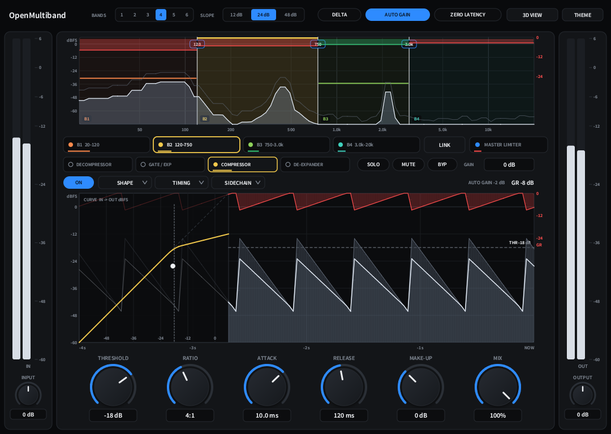
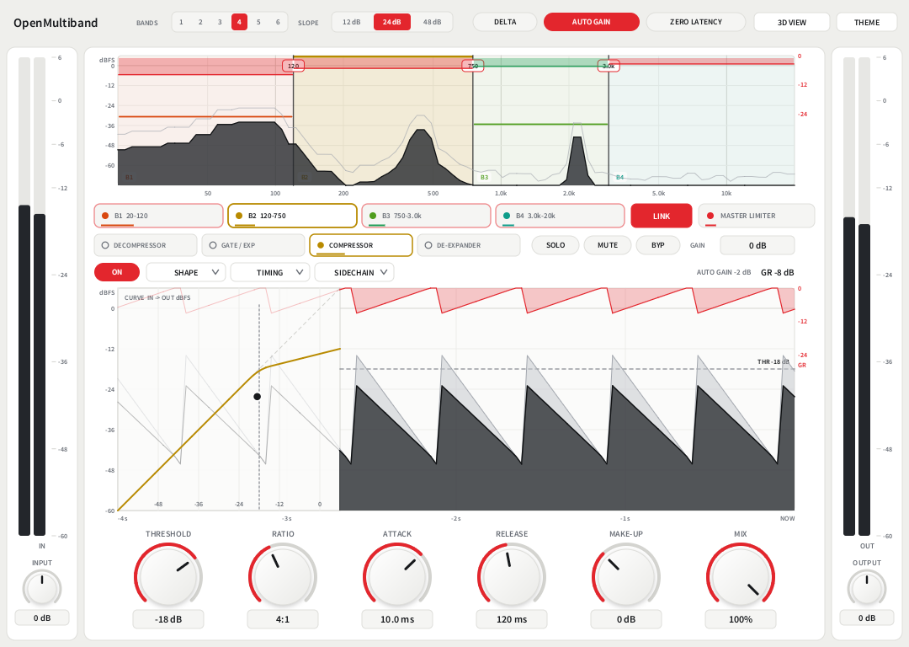
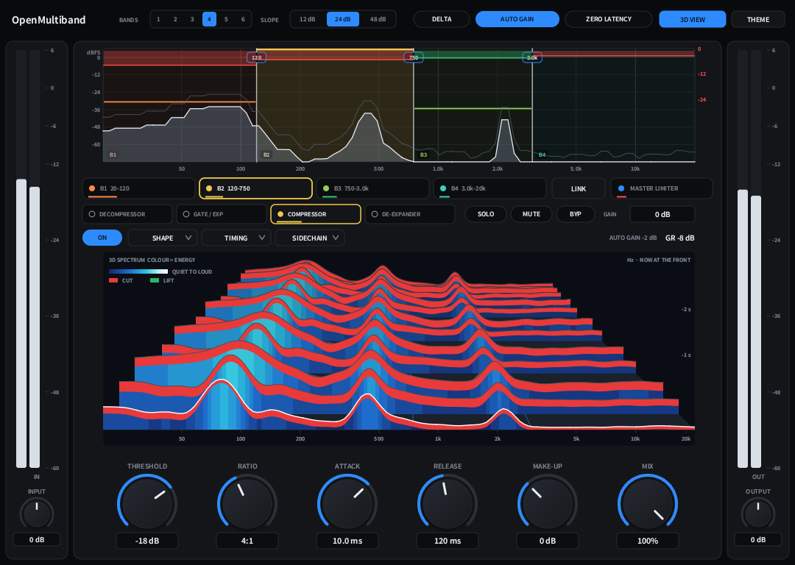
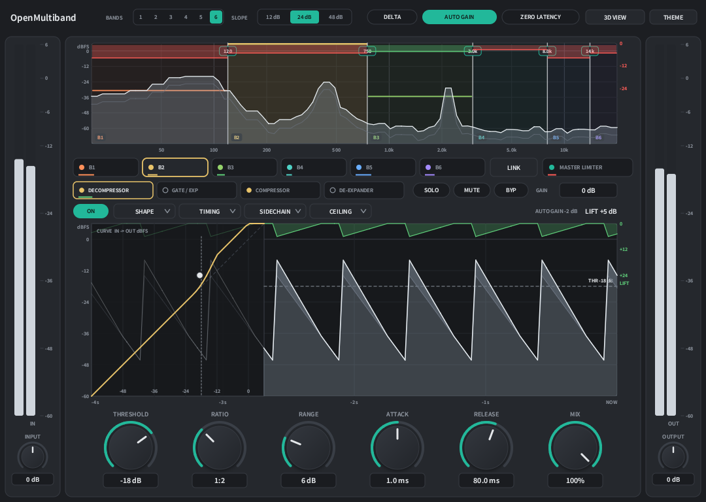
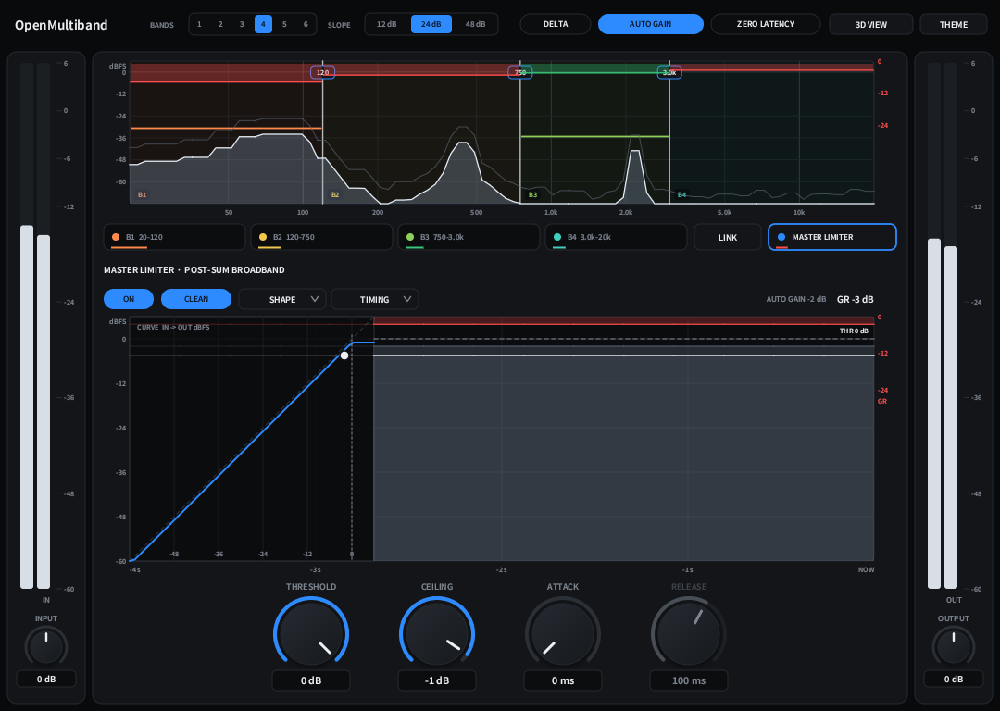

# OpenMultiband

**A 1-to-6-band Linkwitz-Riley multiband dynamics processor with four pure-gain dynamics sections per band, Band Link, and a broadband Master Limiter.**
By OpenGrid.



| Band Link (Light) | 3D spectrum | 6-band Decompressor | Master Limiter |
|---|---|---|---|
|  |  |  |  |

## Version 1.0.0 Beta

- 1-to-6-band minimum-phase all-pass-matched Linkwitz-Riley crossover (12, 24 or 48 dB/oct) with draggable split handles.
- Four sections per band in signal order — Decompressor, Gate / Expander, Compressor and De-Expander — with automatic band latency alignment before summing.
- **Band Link** edits matching controls across all active bands together from any band while keeping Solo, Mute, Bypass and host automation independent.
- Post-sum broadband Master Limiter (with Clean mode and Bass Hold), Zero Latency, BS.1770 Auto Gain and phase-matched Delta listening mode.
- Interactive crossover spectrum, static transfer curve inside a 4-second level history, 3D spectrum view and seven colour themes.

## Download

From the [1.0.0 Beta release](https://github.com/MistaMin/OpenMultiband/releases/tag/v1.0.0-beta):

| Download | System | Formats |
|---|---|---|
| [`OpenMultiband-1.0.0-Beta-macos.pkg`](https://github.com/MistaMin/OpenMultiband/releases/download/v1.0.0-beta/OpenMultiband-1.0.0-Beta-macos.pkg) | macOS 11 or later, Apple silicon and Intel (universal) | VST3, Audio Unit, CLAP, LV2, AAX |
| [`OpenMultiband-1.0.0-Beta-windows-x64-setup.exe`](https://github.com/MistaMin/OpenMultiband/releases/download/v1.0.0-beta/OpenMultiband-1.0.0-Beta-windows-x64-setup.exe) | Windows 10 or later, x64 | VST3, CLAP, LV2 |
| [`OpenMultiband-1.0.0-Beta-linux-x86_64.tar.gz`](https://github.com/MistaMin/OpenMultiband/releases/download/v1.0.0-beta/OpenMultiband-1.0.0-Beta-linux-x86_64.tar.gz) | Linux x86_64 (glibc 2.35+) | VST3, CLAP, LV2 |
| [`OpenMultiband-User-Manual.pdf`](https://github.com/MistaMin/OpenMultiband/releases/download/v1.0.0-beta/OpenMultiband-User-Manual.pdf) | All systems | User manual and parameter reference |

The macOS installer lets you choose any combination of VST3, Audio Unit, CLAP, LV2 and AAX, and installs the manual
and licences into `/Library/Application Support/OpenMultiband`. It is signed with Developer ID and notarized by Apple;
the AAX bundle is digitally signed with PACE Eden for Pro Tools. The Windows installer is not code-signed, so
SmartScreen may ask before it runs.

**Limits of this release:** Windows and Linux binaries are built by GitHub Actions and passed the automated tests only,
not a DAW host; no standalone app; Logic Pro and Studio One have not been tested.

## User guide

- [User manual](docs/USER_MANUAL.md) (PDF in each release) and [parameter reference](docs/PARAMETERS.md)
- [Changelog](CHANGELOG.md) and [release notes](RELEASE_NOTES.md)

## How it works

### Crossover and band routing

Input splits through an all-pass-matched Linkwitz-Riley crossover (1 to 6 bands, default 4 at 120 Hz, 750 Hz and
3.00 kHz; 12, 24 or 48 dB/oct). Every band aligns automatically to the longest active band's latency before summing,
and each band has Gain (-24 to 24 dB), Solo, Mute and click-free Bypass.

### Per-band sections (in signal order)

| Section | What it does |
|---|---|
| Decompressor | Upward expansion above a threshold: restores transients flattened by earlier compression. Optional sample- or true-peak ceiling and crest matching |
| Gate / Expander | Gate with range, hysteresis and hold, or downward expander with ratio and knee |
| Compressor | Feed-forward compression, soft knee centred on the threshold, exact ratio, make-up and parallel mix |
| De-Expander | Upward compression of quiet passages below a threshold, above a noise floor |

Every per-band section supports look-ahead (up to 10 ms), auto attack and auto release, stereo link, and a full
sidechain filter (internal or external key through high-pass, low-pass and bell filters at once). Toggle **LINK** in the
band bar to move matching controls across all active bands together by the same relative amount.

### Master stage and global controls

After band summing, a broadband **Master Limiter** (Clean mode holds reduction across bass cycles with crest-adaptive
release) controls peaks before Output Gain. Global **Zero Latency** drops all look-ahead for 0-sample latency;
**Auto Gain** matches loudness (BS.1770, 3 s window); **Delta** auditions the exact processing difference against an
all-pass-matched dry reference.

## Build from source

Rust (stable). Builds against [OpenPluginSDK](https://github.com/MistaMin/OpenPluginSDK) and
[GoodLookin DRI](https://github.com/MistaMin/GoodLookinDri) checked out beside it
(`../../Dependencies/OpenPluginSDK`, `../../Dependencies/GoodLookinDri`).

```bash
cargo test --release --workspace   # DSP, plugin, layout and Band Link tests
./scripts/build.sh                 # macOS universal bundles into dist/ (needs VST3, AU and optional AAX SDKs)
```

Windows and Linux builds, their installer and archive, run in GitHub Actions (`.github/workflows/build.yml`).
`tools/build_user_manual.py` builds `output/pdf/OpenMultiband-User-Manual.pdf`; `scripts/make_installer.sh` builds,
signs and notarizes the macOS `.pkg` installer; `tools/write_manifest.py` writes `opengrid-manifest.json`.

| Folder | Contents |
|---|---|
| `src/` | plugin core, Linkwitz-Riley crossover (`crossover.rs`), Auto Gain, shared telemetry, editor (`src/ui/`) |
| `crates/` | per-section DSP (`dynamics`, `dyn-decompress`, `dyn-deexpand`, `api`) |
| `docs/` | user manual, generated parameter reference, editor screenshots |
| `Licenses/` | third-party licence texts bundled in the installers |
| `installer/`, `scripts/`, `tools/` | Windows Inno Setup script, macOS build and installer scripts, PDF manual and manifest generators |
| `qa/` | non-proprietary test evidence |

## License

Source code: MIT, see [LICENSE](LICENSE). Copyright (c) 2026 Marcos Quirino Deida. Official compiled binaries are
proprietary freeware under [BINARY_LICENSE.txt](BINARY_LICENSE.txt). Third-party components and licences:
[THIRD_PARTY_LICENSES.md](THIRD_PARTY_LICENSES.md).

VST is a trademark of Steinberg Media Technologies GmbH. Audio Units is a trademark of Apple Inc. AAX and Pro Tools are
trademarks of Avid Technology, Inc.
