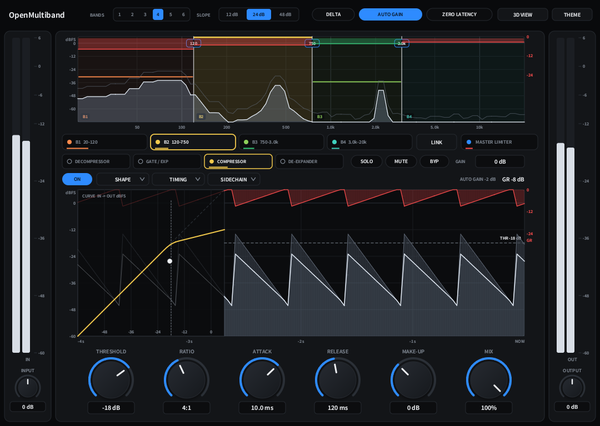
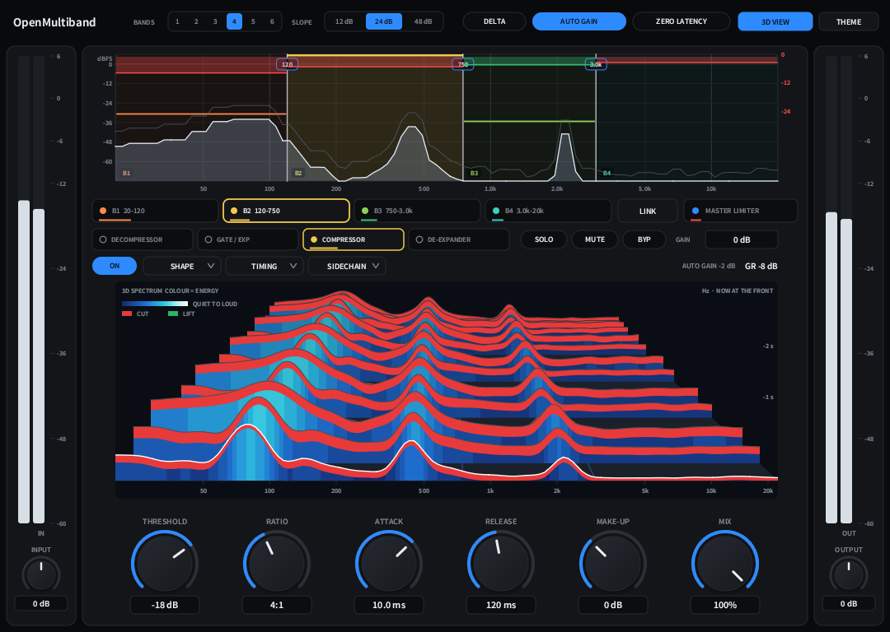
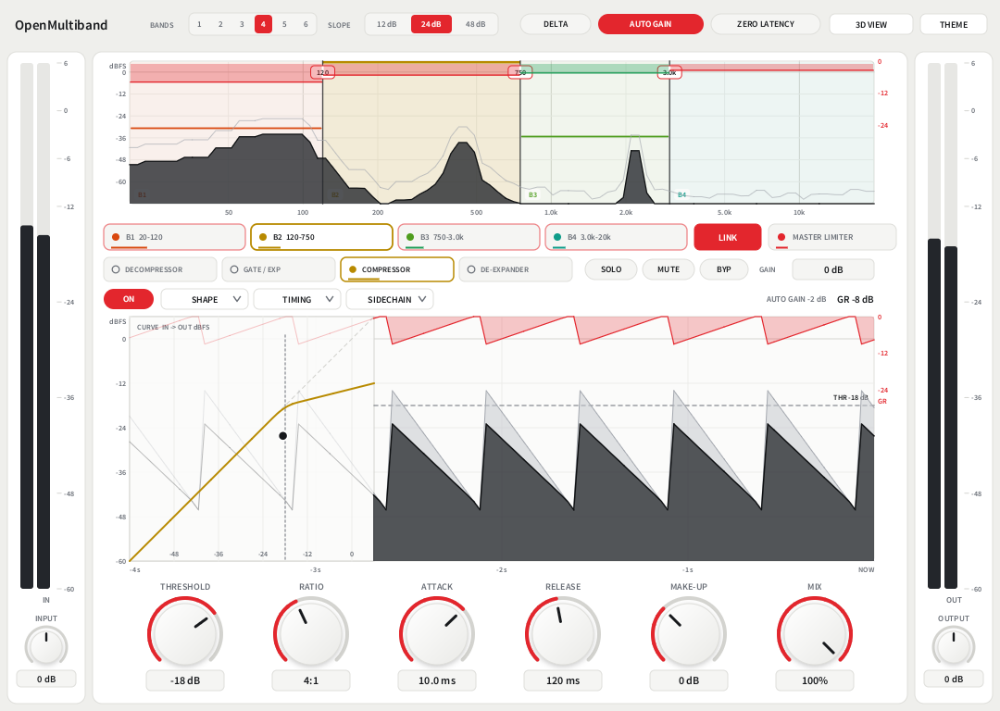
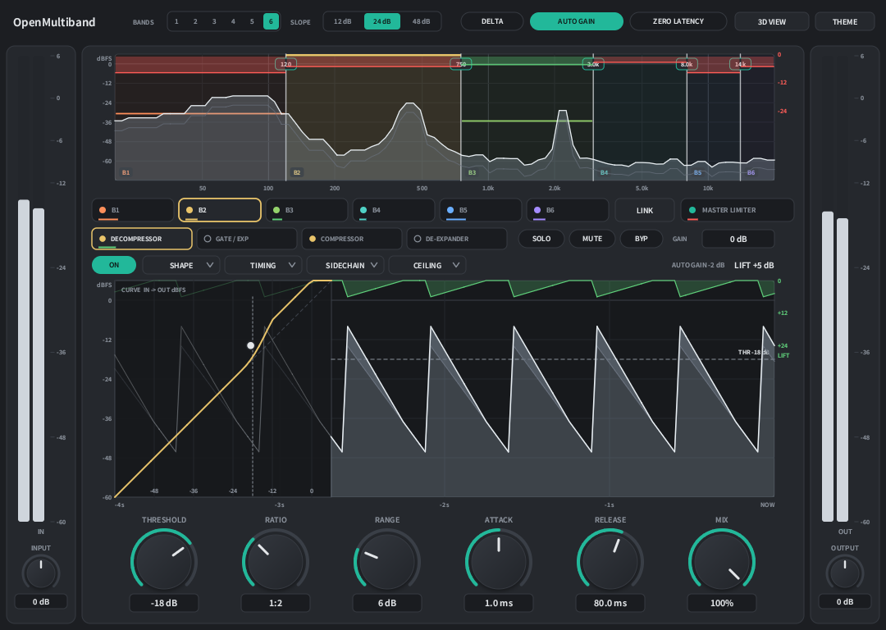
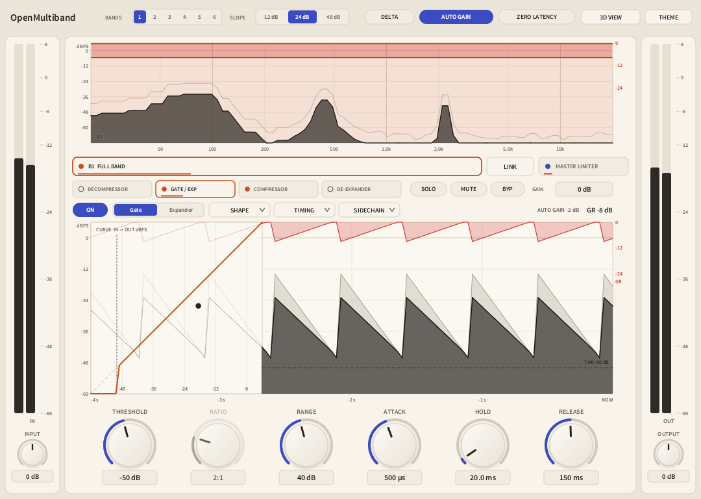
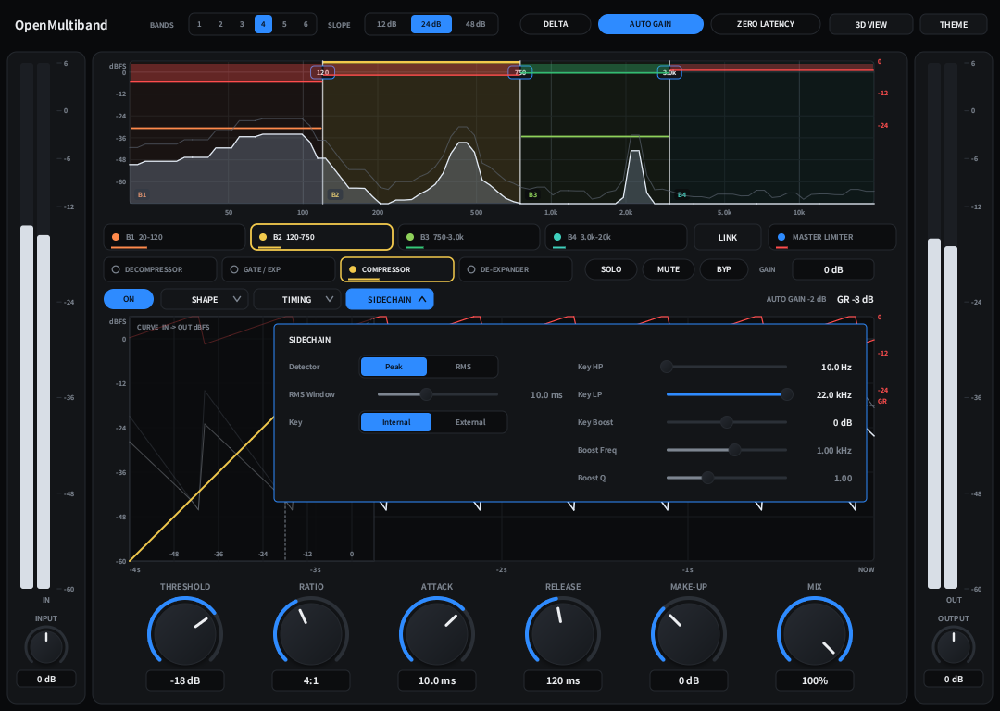
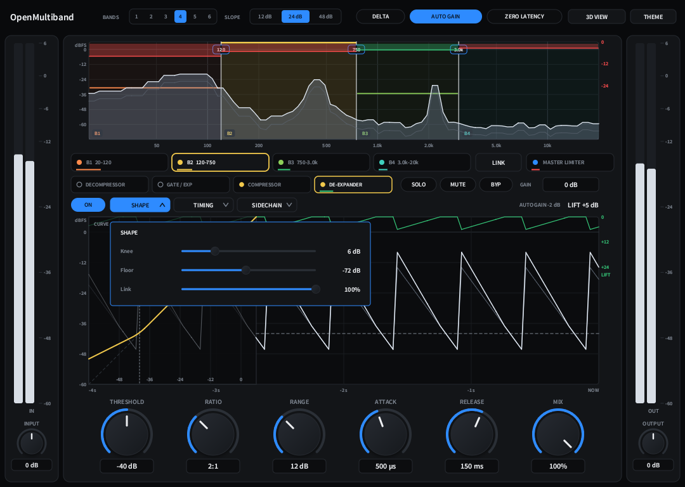
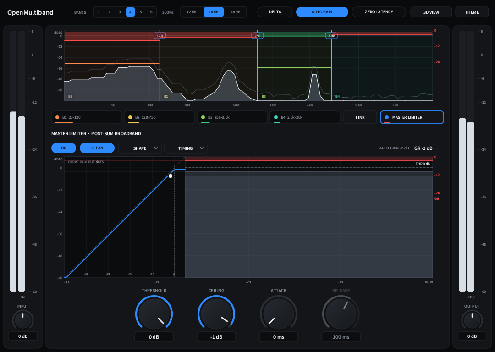

# OpenMultiband User Manual

OpenMultiband is a 1-to-6-band multiband dynamics processor by OpenGrid. It splits the signal through an
all-pass-matched Linkwitz-Riley crossover, runs four independent pure-gain dynamics sections inside every
band, latency-aligns the bands before summing, and finishes with a broadband Master Limiter.

## Signal flow

Audio flows in this order:

- **Input Gain** into the **Linkwitz-Riley Crossover** (1 to 6 bands, 12 / 24 / 48 dB/oct).
- **Per band:** **Decompressor** -> **Gate / Expander** -> **Compressor** -> **De-Expander** -> **Band Latency Align** -> **Band Gain / Bypass / Solo / Mute**.
- **Band Sum** into the broadband **Master Limiter** -> **Output Gain** -> **Delta** -> **Auto Gain** -> **Output**.

Every band automatically aligns to the longest active band's latency before summing, keeping crossovers
phase-coherent even when individual bands use different look-ahead times. The dry reference passes through
a matched all-pass chain and the total latency delay so **Delta** mode nulls cleanly at unity across all
band counts and slopes.

| Stage | What it does |
|---|---|
| Crossover | Splits stereo audio into 1 to 6 bands (default 4) using minimum-phase all-pass-matched Linkwitz-Riley filters at 12, 24 (default), or 48 dB/oct |
| Decompressor | Upward expansion above the threshold: brings back transients that earlier compression flattened. Optional sample- or true-peak ceiling and crest matching (ceiling starts off in OpenMultiband because the Master Limiter follows the band sum) |
| Gate / Expander | A gate with range, hysteresis and hold, or a downward expander with ratio and knee |
| Compressor | Feed-forward compression with soft knee centred on the threshold, exact ratio, make-up and mix |
| De-Expander | Upward compression of quiet passages below the threshold, above a noise floor |
| Master Limiter | Broadband peak limiter after the band sum. Clean mode holds the reduction over bass cycles and sets the release from the programme's crest factor |

New instances start with 4 bands (splits at 120 Hz, 750 Hz and 3.00 kHz, 24 dB/oct), the **Compressor** on in
every band, and the **Master Limiter** on.

## The window

- **Header bar:** **Bands** (1 to 6), **Slope** (12 dB, 24 dB, 48 dB), global **DELTA**, **AUTO GAIN**, **ZERO LATENCY**, **3D VIEW** and **THEME** (Light, Dark, Graphite, Paper, Slate, Neon and Rosé).
- **Input and output rails** on the left and right: stereo peak meters and **Input Gain** / **Output Gain** knobs (-24 to 24 dB).
- **Crossover spectrum display** at the top: live pre/post spectrum across 20 Hz to 20 kHz, per-band gain-reduction bars and draggable vertical crossover handles. Drag any split handle horizontally to move the crossover frequency; double-click a handle to type a frequency directly.
- **Band bar:** selects the edited band (`B1`..`B6`), displays each band's live gain offset, and holds the **LINK** toggle and **MASTER LIMITER** tab.
- **Section bar:** selects one of the four per-band sections (**DECOMPRESSOR**, **GATE / EXP**, **COMPRESSOR**, **DE-EXPANDER**) with lit activity dots, alongside the selected band's **SOLO**, **MUTE**, **BYP** (click-free 10 ms crossfade bypass) and **Band Gain** (-24 to 24 dB).
- **Settings panels:** **SHAPE**, **TIMING**, **SIDECHAIN** (and **CEILING** on the Decompressor) open compact slider panels over the display for secondary controls. Click the panel button again, or click outside the panel, to close it.
- **Main display:** the active section's static transfer curve (with a moving operating-point dot) inside a four-second level and gain-reduction history. **3D VIEW** switches the display to a 3D full-band spectrum over time.
- **Main knobs** along the bottom: the six primary controls of the selected section. Drag vertically, scroll with the mouse wheel, or double-click any knob or numeric readout to type an exact value (`-18 dB`, `4:1`, `500 us`, `2.5 kHz`).

Values display in whole dB and whole ratios. Times below 1 ms show in microseconds, and frequencies from
1000 Hz show in kHz.

## Band Link

Click **LINK** in the band bar to edit matching parameters across all active bands together:

- **Continuous controls** (Threshold, Ratio, Attack, Release, Knee, Make-Up, Mix, Band Gain, sidechain filters, etc.): moving a control on the selected band applies the same relative delta (in normalized taper space) to the corresponding control on every other active band, clamping cleanly at each band's range limits.
- **Switches and choices** (section On, Mode, Detector, Key Source, Auto Attack, Auto Release, Ceiling On, Match On): changing a toggle or choice on the selected band sets all other active bands to match.
- **Independent controls:** Band **SOLO**, **MUTE**, and **BYP** always stay independent per band so you can audition or compare bands while linked.
- **Host automation:** **LINK** is an editor workflow aid, not a host parameter. Automated lanes and host parameter writes continue to address each band independently.

## Global controls

| Control | What it does |
|---|---|
| Input Gain, Output Gain | Level into the crossover and out of the Master Limiter, -24 to 24 dB |
| Bands | Active crossover band count, 1 to 6 (default 4). Switching dips output smoothly for 5 ms |
| Crossover Slope | Minimum-phase Linkwitz-Riley slope: 12 dB, 24 dB (default), or 48 dB per octave |
| Crossover 1 to 5 | Split frequencies from 20.0 Hz to 20.0 kHz (defaults: 120 Hz, 750 Hz, 3.00 kHz, 8.00 kHz, 14.0 kHz) |
| Zero Latency | Drops every section's look-ahead so the plugin reports 0 samples latency. Sections react from the first sample of a peak instead of looking ahead |
| Auto Gain | Matches output loudness to the input (BS.1770 weighting, three-second average, up to ±24 dB). A listening aid: switch off before printing |
| Delta | Plays only what the dynamics changed: output minus the all-pass-matched, latency-aligned input. Switch off before printing |

## Controls common to every per-band section

| Control | What it does |
|---|---|
| Threshold | Level where the section starts acting |
| Ratio | Slope of the static transfer curve beyond the threshold |
| Knee | Width in dB of the soft knee, centred on the threshold |
| Attack, Release | Speed toward more and less gain change |
| Auto Attack, Auto Release | Adapts timing to the programme: faster on short transients, slower on sustained material |
| Look-Ahead | Delays audio so gain lands on a transient's first sample (0 to 10 ms). Adds latency; bypassed under Zero Latency |
| Stereo Link | 100% links L/R detection; 0% detects left and right channels independently |
| Detector | Peak or RMS (plus Transient on the Decompressor) |
| RMS Window | Averaging window of the RMS detector |
| Key Source | Internal (the band's own input) or External (the plugin's sidechain bus, where the host provides one) |
| Key HP, Key LP | High-pass and low-pass filters on the key signal |
| Key Boost, Boost Freq, Boost Q | Bell filter on the key signal to emphasise or de-emphasise a frequency band (works simultaneously with Key HP and Key LP) |

## Decompressor

Raises levels above the threshold by the ratio 1:x, up to **Range**, restoring punch in compressed bands.
In **Transient** detector mode the threshold rides **Crest** dB above the band's slow RMS body so attacks
lift while sustained material stays intact. **Output Trim** scales the result.

In the **CEILING** panel:

- **Ceiling** on (starts off by default in OpenMultiband): caps the section output at **Ceiling Level** using **Sample peak** or **True peak** detection.
- **Match** on: adjusts upward expansion automatically to target **Match Crest**.

## Gate / Expander

In **Gate** mode the section attenuates by up to **Range** below the threshold, with **Hysteresis** and **Hold**
to prevent chatter. In **Expander** mode it lowers quiet passages smoothly by **Ratio** and **Knee**, capped by **Range**.

## Compressor

Feed-forward per-band compression with soft knee, exact ratio, **Make-Up** gain and parallel **Mix**. Every
band's Compressor starts enabled by default.

## De-Expander

Upward compression of quiet passages below the threshold (up to **Range**), while material at or below **Floor**
is left untouched so background noise is not lifted.

## Master Limiter

A broadband peak limiter running after the bands sum, keeping output under **Ceiling** while **Threshold**
sets drive. **Clean** (on by default) holds reduction across bass cycles (up to **Bass Hold**) to prevent low-frequency
waveform modulation and adapts release from programme crest factor. With **Clean** off, **Release** and
**Auto Release** apply directly.

## Formats and hosts

- **macOS 11 or later (Apple silicon and Intel, universal):** VST3, Audio Unit, CLAP, LV2 and PACE Eden-signed AAX (Pro Tools).
- **Windows 10 or later (x64):** VST3, CLAP and LV2.
- **Linux (x86_64):** VST3, CLAP and LV2.
- No standalone application is included in this release.
- macOS builds were verified in REAPER (VST3, CLAP, Audio Unit), OpenGrid9 (VST3, Audio Unit, LV2), and Pro Tools Studio 2025.10 (AAX), plus `auval`, `clap-validator`, `pluginval` (strictness 10), and `AAX Validator`. Logic Pro and Studio One have not been tested. Windows and Linux binaries are built by GitHub Actions and pass the automated tests only (not yet verified in a Windows or Linux DAW).

## Licence

Every parameter with its range and default is listed in the parameter reference that follows (`docs/PARAMETERS.md`).

Source code is MIT licensed (`LICENSE`). Official compiled binaries are proprietary freeware under `BINARY_LICENSE.txt`.
Third-party components and licences are listed in `THIRD_PARTY_LICENSES.md`. Copyright (c) 2026 Marcos Quirino Deida.

VST is a trademark of Steinberg Media Technologies GmbH. Audio Units is a trademark of Apple Inc.
AAX and Pro Tools are trademarks of Avid Technology, Inc.
